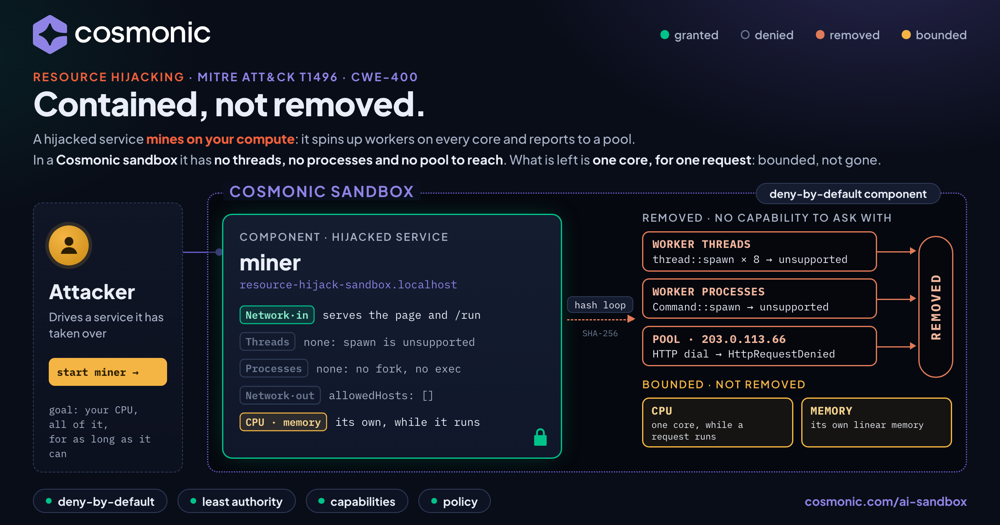

# Resource Hijacking in a Sandbox: contained, not removed

**Read the full story on the Cosmonic blog:** [TODO: blog post URL](https://cosmonic.com/blog/TODO-resource-hijacking-in-a-sandbox/)



Resource hijacking ([MITRE ATT&CK T1496](https://attack.mitre.org/techniques/T1496/)) is the
attack where someone else's work runs on your compute: a taken-over service starts hashing, spreads
across every core, and reports to a pool. This repo runs a stand-in for that inside a
deny-by-default [Cosmonic](https://cosmonic.com/) sandbox and measures what the sandbox does about
each step.

This is the honest one. In the other demos in this series the attack has nothing to work with. Here
it does: **code that is allowed to run is allowed to compute.** The sandbox removes the miner's
workers and its pool, and it bounds the rest. It does not make the CPU loop go away.

> **You can't execute what you don't have**, and three of the miner's five moves need something it
> was never handed. The other two need only what every running program has: its own CPU time and
> its own memory. Those are *bounded*, and this README says by what, with the numbers.

The "miner" is a stand-in: an iterated SHA-256 loop over a counter. There is no mining protocol, no
pool client, no wallet and no difficulty target in this repo. The "pool" is `203.0.113.66`
(TEST-NET-3, RFC 5737, never routed) and `pool.attacker.example` (RFC 2606, never resolvable).

## The scenarios

The demo page has one button per scenario. Every attempt is really made inside the component, and
the answer shown is the one that came back. Measured on Cosmonic Desktop 0.5.32 (runtime 2.12.0,
macOS/aarch64) with the manifest in [`deploy/`](deploy/resource-hijack-sandbox.workload.yaml).

| Button | Technique (ATT&CK / CWE-400) | What the attack does | In the sandbox |
|---|---|---|---|
| **Start miner** | [T1496](https://attack.mitre.org/techniques/T1496/) Resource Hijacking | Dials the pool, starts 8 worker threads and 3 worker processes, then hashes | **Contained, not removed.** 13,936,640 hashes in 3,000 ms on one core. 0 of 11 workers created. 0 of 2 pool dials connected. |
| **CPU loop** | [T1496.001](https://attack.mitre.org/techniques/T1496/001/) Compute Hijacking · CWE-400 | Hashes for as long as it is allowed | ***Bounded.*** It runs, at about 4.6 million hashes/s (a native thread on the same machine does 5.2 million). It stopped at the 3 s cap built into the component. No platform CPU limit interrupted it. |
| **Spawn workers** | T1496.001: scale out to every core | `std::thread::Builder::spawn` × 8; `std::process::Command::spawn` × 3 | ***Removed.*** 0 of 11 created: `operation not supported on this platform`. The component imports no thread or process interface, so there is nothing to call. |
| **Grow memory** | T1496 / [T1499](https://attack.mitre.org/techniques/T1499/) Endpoint DoS · CWE-400, CWE-770 | `memory.grow` in 16 MiB steps until refused | ***Bounded.*** Grew from 1.7 MiB to 256 MiB, the ceiling built into the component. The runtime did not refuse, although the manifest declares `memoryLimitMb: 64`. The memory is gone when the instance is dropped, which is after this one request. |
| **Dial pool** | T1496: reach the pool ([T1071](https://attack.mitre.org/techniques/T1071/)) | One HTTP request each to `203.0.113.66:3333` and `pool.attacker.example:3333` | ***Removed.*** Both `ErrorCode::HttpRequestDenied`. `allowedHosts: []`, and the host logs `allowed_hosts policy is empty (deny-all)`. |
| **Persist** | T1496: keep working after the request | Returns its response, then keeps hashing in a background task | ***Bounded.*** With `maxInvocations: 1` the instance is dropped after its request: 0 background steps completed in 5 of 5 runs. Without that setting the work carried on (see below). |
| **Run evasion probe** | resource-limit evasion | 13 variants: 4 ways to start a thread, 3 to start a process, 6 memory-growth patterns | 13 variants tried, 0 exceeded the budget of 0 workers and the component's 256 MiB ceiling. Against the *declared* 64 MiB limit, 6 of 13 exceeded it. See [Findings](#findings). |

## Contained, not removed

Deny-by-default works by not handing code a capability. That is why the three *removed* rows are
strong: there is no thread interface, no process interface and no allowed host, so there is nothing
for a clever input to get around.

CPU time and memory are different. They are not capabilities a component asks for; they are what
running *is*. So the question for those rows is not "is it denied?" but "what bounds it, and did
that bound actually fire?" Here is what was measured, without rounding up.

**What the sandbox takes away (measured):**

- **More cores.** A component has one thread. All 8 thread spawns and all 3 process spawns failed.
  The hijacked code gets one core per request, where the [native baseline](native-demo/README.md)
  took 8 cores for 6.6 times the hash rate.
- **The pool.** With no egress the hashes have nowhere to go. A miner that cannot submit work earns
  nothing, which removes the motive even though it does not stop the heat.
- **Staying resident.** There is no disk to install onto, no process to leave behind and, with
  `maxInvocations: 1`, no instance that survives the request.

**What bounds the rest, on this host (measured):**

| Bound | Declared in the manifest | What happened |
|---|---|---|
| Egress | `allowedHosts: []` | **Enforced.** Every dial denied before a connection was attempted. |
| Instance lifetime | `maxInvocations: 1` | **Enforced.** Every request got a fresh instance (`invocation_in_this_instance: 1` every time). Memory grown to 256 MiB by one request was back to 1.7 MiB for the next. Background work left running after a response completed 0 steps, in 5 of 5 runs. |
| Operator stop | `cosmonic_workload_stop` | **Enforced.** A background task that was logging a heartbeat every 5 s stopped within one interval of the stop. |
| Memory | `memoryLimitMb: 64` | **Not enforced on this host.** The component grew to 256 MiB and stopped only at its own ceiling. |
| CPU | `cpuLimit: 1` | **No observable effect on this host.** The loop ran at 89% of native single-thread speed with or without the setting, and nothing interrupted it in 3 s. A component is single-threaded, so one core is already its maximum. |
| Request timeout | none found in the Workload schema | **None observed.** A request that only waited (no CPU) stayed open for the full 120 s it asked for. |

So on Cosmonic Desktop today, the CPU bound on a hijacked component is this: **one core, for as
long as its request stays open, and no longer if `maxInvocations: 1` is set.** That is a real
bound, and it is a much smaller prize than a container gives up. It is not a CPU quota. In this
demo the thing that stopped every burn after 3 seconds was a cap written into the component, put
there so a missing platform limit could not leave a loop running on the machine. Real hijacked code
would not include one.

**Why `maxInvocations: 1` matters.** With the default warm pool and no `maxInvocations`, the same
component behaved differently, and this was measured too:

- a request that had already returned its response kept hashing for its full 3,000 ms (12 of 12
  slices), ended only by the in-component cap;
- a no-CPU background task was still alive 60 s after its response (12 of 12 heartbeats), again
  ended only by its own cap;
- memory grown to 256 MiB stayed at 256 MiB for every later request to that instance.

A warm pool is a throughput feature, and it keeps instances alive on purpose. For a component you
do not fully trust, `maxInvocations: 1` trades that throughput for a hard end to every request.

**What you still need.** A quota on the host itself. On Kubernetes with
[Cosmonic Control](https://cosmonic.com/control/) the host runs in a pod, and the pod's CPU and
memory `resources.limits` are the outer bound on everything every component in it does. That is
the standard Kubernetes mechanism and it was **not measured in this repo**, which only ran on
Desktop. On Desktop there is no equivalent per-component quota that we could observe.

## Quickstart

1. **Install [Cosmonic Desktop](https://cosmonic.com/desktop/).** It runs WebAssembly components as
   sandboxed workloads on macOS, Windows and Linux, and listens on `127.0.0.1:8200`.
2. **Build and push the image**, then apply the manifest. The image lives in Desktop's built-in
   registry, so it has to be built once (see [Build from source](#build-from-source)). The easiest
   route is an AI assistant connected to Desktop's MCP server
   ([Connect coding agents](https://cosmonic.com/docs/desktop/coding-agents/)):

   > "Apply `deploy/resource-hijack-sandbox.workload.yaml` to Cosmonic Desktop, then show me its
   > status."

3. **Open <http://resource-hijack-sandbox.localhost:8200/>** and press **Start miner**.
   `/#miner`, `/#cpu`, `/#spawn`, `/#memory`, `/#pool`, `/#persist` and `/#probe` press a button on
   load.

Each button costs at most 3 seconds of one core. Nothing keeps running afterwards.

### From the command line

| Scenario | Run it | Cost |
|---|---|---|
| Start miner | `/run?mode=miner` (the default) | 3 s of one core |
| CPU loop | `/run?mode=cpu` (`&ms=500` for a shorter run; 3000 is the maximum) | up to 3 s of one core |
| Spawn workers | `/run?mode=spawn` | none |
| Grow memory | `/run?mode=memory` | up to 256 MiB, for one request |
| Dial pool | `/run?mode=pool` | none |
| Persist | `/run?mode=persist`, then `/run?mode=status` | up to 3 s of one core if the instance survives |
| Persist, no CPU | `/run?mode=persist&kind=heartbeat&secs=30` | none |
| Open request, no CPU | `/run?mode=idle&secs=10` (120 is the maximum) | none |
| Evasion probe | `/probe` lists the variants; `/probe?variant=NAME` runs one | up to 256 MiB, for one request |

```bash
B=http://127.0.0.1:8200; H='Host: resource-hijack-sandbox.localhost'

curl -s -H "$H" "$B/run?mode=miner"     # pool + workers + CPU, as JSON
curl -s -H "$H" "$B/run?mode=memory"
probe/run.sh                            # the evasion probe, one request per variant
```

`mode=miner`, captured from the live workload. Trimmed and reordered for reading: the descriptive
`attempt`, `class` and `note` fields, the hash rate and digest, and two of the three process
attempts are left out. Every value shown is as returned.

```json
{
  "mode": "miner",
  "technique": "T1496 Resource Hijacking (CWE-400)",
  "verdict": "CONTAINED, NOT REMOVED: the miner ran. 13936640 hashes in 3000 ms on one core, stopped by the in-component cap. 0 of 11 worker threads/processes created. 0 of 2 pool dials connected.",
  "cpu": {
    "ran": true,
    "hashes": 13936640,
    "elapsed_ms": 3000,
    "in_component_cap_ms": 3000,
    "stopped_by": "in-component cap",
    "stopped_by_detail": "the loop ran its full 3000 ms and stopped itself; no platform limit interrupted it within that window"
  },
  "threads": {
    "attempted": 8,
    "spawned": 0,
    "error": { "kind": "Unsupported", "error": "operation not supported on this platform" },
    "available_parallelism": {
      "err": { "kind": "Unsupported", "error": "getting the number of hardware threads is not supported on the target platform" }
    }
  },
  "processes": {
    "attempted": 3,
    "spawned": 0,
    "attempts": [
      {
        "command": "/bin/sh -c nproc",
        "spawned": false,
        "error": { "kind": "Unsupported", "error": "operation not supported on this platform" }
      }
    ]
  },
  "pool": {
    "attempted": 2,
    "connected": 0,
    "attempts": [
      { "target": "203.0.113.66:3333", "connected": false, "denied_by_policy": true, "runtime_error": "ErrorCode::HttpRequestDenied" },
      { "target": "pool.attacker.example:3333", "connected": false, "denied_by_policy": true, "runtime_error": "ErrorCode::HttpRequestDenied" }
    ]
  },
  "instance": {
    "invocation_in_this_instance": 1,
    "linear_memory_mb_at_entry": 1.6875,
    "linear_memory_mb_now": 1.6875
  }
}
```

`mode=memory`:

```json
{
  "mode": "memory",
  "verdict": "BOUNDED, NOT REMOVED: memory grew from 1.6875 MiB to 256.0 MiB, stopped by the in-component cap.",
  "memory": {
    "start_mb": 1.6875,
    "reached_mb": 256.0,
    "successful_grows": 16,
    "in_component_ceiling_mb": 256,
    "stopped_by": "in-component cap",
    "stopped_by_detail": "growth reached the 256 MiB ceiling built into the component; the runtime had not refused"
  }
}
```

Two things about reading these. `stopped_by` can only say `in-component cap` or `platform`; if a
platform CPU limit ever ends an invocation you get an HTTP error and no JSON, and the page says so.
And the thread and process errors are labelled `error`, not `runtime_error`, because they come from
Rust's standard library: on `wasm32-wasip2` it has no interface to call, so it fails the attempt
itself. The fact underneath is the import list, below.

## The evasion probe

[`probe/run.sh`](probe/run.sh) asks the component for its variants and runs them one request at a
time, in order, with no parallelism. A variant *exceeds the budget* if it creates any worker, or
ends up holding more memory than the limit it is checked against.

```
variant                  result                     answer
thread-builder           0 of 1 created             operation not supported on this platform
thread-stack-size        0 of 1 created             operation not supported on this platform
thread-scoped            0 of 1 created             operation not supported on this platform
thread-burst             0 of 64 created            operation not supported on this platform
process-spawn            0 of 1 created             operation not supported on this platform
process-output           0 of 1 created             operation not supported on this platform
process-status           0 of 1 created             operation not supported on this platform
memory-grow-1-page       1.6875 -> 256 MiB          stopped by in-component cap
memory-grow-16mb         1.6875 -> 256 MiB          stopped by in-component cap
memory-grow-one-jump     1.6875 -> 256 MiB          stopped by in-component cap
memory-vec-64k           1.6875 -> 256 MiB          stopped by in-component cap
memory-vec-1mb           1.6875 -> 255.688 MiB      stopped by in-component cap
memory-vec-one-large     1.6875 -> 255.875 MiB      stopped by in-component cap

13 variants tried, 0 exceeded the budget (0 workers; memory: in-component ceiling 256 MiB).
```

Every memory variant starts at 1.6875 MiB because `maxInvocations: 1` gives each request a fresh
instance. `MEMORY_LIMIT_MB=64 probe/run.sh` checks the same runs against the limit the manifest
declares instead of the component's own ceiling.

## Findings

Recorded as measured on Cosmonic Desktop 0.5.32, runtime 2.12.0, macOS/aarch64.

1. **`memoryLimitMb` is accepted and stored, and not enforced.** With
   `localResources.memoryLimitMb: 64` in the applied spec (confirmed with `cosmonic_workload_get`),
   all six memory variants passed 64 MiB and reached about 256 MiB:
   `13 variants tried, 6 exceeded the budget (0 workers; memory: declared memoryLimitMb 64)`.
   The only memory bound that fired was the component's own. Flagged for upstream report.
2. **`cpuLimit` had no observable effect.** The 3 s loop produced the same hash rate with
   `cpuLimit: 1` and with the field absent, and was never interrupted. This probe cannot tell
   "not enforced" from "enforced at one core", because a component cannot use more than one.
3. **Work continues after the response when the instance is pooled.** With the default pool
   (`poolSize: 1`, `maxInvocations: 0`) a task spawned before the handler returned ran its whole
   3,000 ms of hashing, and a no-CPU task was alive 60 s later. `maxInvocations: 1` ended both: 0
   steps completed in 5 of 5 runs. The shipped manifest sets it.
4. **No request timeout was observed.** An idle request stayed open for 120,323 ms.
5. **The Workload validator accepts unknown fields.** `cosmonic_workload_validate` returned
   `valid: true` for a spec carrying invented `timeout`, `fuel` and `bogusField` keys, so a
   misspelled limit will not be reported.

## Status

Built, deployed and verified on Cosmonic Desktop. What this repo did **not** measure:

- **Concurrency.** Everything here is one request at a time, on purpose: this is a working
  machine. How many cores N simultaneous requests can occupy was not tested. The bound above is
  per request, not per workload.
- **CPU past 3 seconds.** Every burn is capped inside the component, so "no platform limit fired"
  means "none fired within 3 s".
- **Idle past 120 seconds**, for the same reason.
- **Kubernetes / Cosmonic Control.** The pod resource limits described above are how the outer
  bound works there; they were not exercised.
- **Scale-to-zero.** Desktop did not scale the workload to zero in anything observed here, and no
  such field was found in the Workload schema. What it does have is `maxInvocations`.

## The long tail

What this demo lets you say about neighbouring techniques, and how far:

| Technique | Standing | Why |
|---|---|---|
| [T1496.001](https://attack.mitre.org/techniques/T1496/001/) Compute Hijacking | **Bounded** | Shown above: one core per open request, no workers, no pool. |
| [T1496.002](https://attack.mitre.org/techniques/T1496/002/) Bandwidth Hijacking | Removed for outbound | Needs egress. Same `allowedHosts: []` denial as the pool dial; not separately tested. A component's own HTTP responses still use bandwidth. |
| [T1496.003](https://attack.mitre.org/techniques/T1496/003/) SMS Pumping, [T1496.004](https://attack.mitre.org/techniques/T1496/004/) Cloud Service Hijacking | Removed, by the same argument | Both work by calling an outside service. No allowed host, and no credentials in the environment. Not separately tested. |
| [T1498](https://attack.mitre.org/techniques/T1498/) Network Denial of Service | Removed as a *source* | The component imports no `wasi:sockets` and cannot make an outbound request, so it cannot flood anyone. This says nothing about a flood aimed *at* the workload. |
| [T1499](https://attack.mitre.org/techniques/T1499/) Endpoint Denial of Service | **Bounded, within the budget above** | A component can exhaust what it is allowed: one core while a request is open, and, on this host, as much memory as it asks for. Read finding 1 before relying on a memory limit. |
| [T1485](https://attack.mitre.org/techniques/T1485/) Data Destruction, [T1486](https://attack.mitre.org/techniques/T1486/) Data Encrypted for Impact | Limited to granted data | This workload mounts no volume, so there is nothing to destroy or encrypt. A component that *is* granted a volume can destroy or encrypt exactly that volume. The sandbox narrows the blast radius to the grant; it does not protect the granted data. Not tested here. |

## See it without a sandbox

[`native-demo/`](native-demo/README.md) runs the same loop directly on macOS or Linux. It is
self-limited: 2 seconds, at most 8 threads, then it exits.

```bash
cd native-demo
cargo run --release
```

```
 STEP 2  start 8 worker threads (std::thread::Builder::spawn)
    8 of 8 threads started
    69316608 hashes in 2.00 s  (34647169 hashes/s)
    6.6x the single-thread rate: the loop spread across 8 cores

 STEP 3  start a child process (std::process::Command)
    spawned: child pid 20787 running as <you>

 STEP 4  dial the pool at 203.0.113.66:3333 (TEST-NET-3, never routed), 1 s timeout
    connection timed out
    nothing refused the attempt: the OS sent the connection request and nobody answered
```

Same loop, same machine. Natively: 8 cores, a child process, and a dial the OS allowed. In the
sandbox: one core, no workers, and a dial refused before it left.

## How it's built

One workload, one WebAssembly component.

| Component | Filesystem | Network | HTTP | Job |
|---|---|---|---|---|
| `miner` | none | no egress | serves `wasi:http/handler` | the UI, and the hijacked code |

Its complete import list, from `cosmonic_image_inspect`:

```
wasi:cli/{environment,exit,stdin,stdout,stderr}@0.2.6
wasi:cli/terminal-{input,output,stdin,stdout,stderr}@0.2.6
wasi:clocks/monotonic-clock@0.2.6   wasi:clocks/monotonic-clock@0.3.0
wasi:clocks/wall-clock@0.2.6        wasi:clocks/types@0.3.0
wasi:http/client@0.3.0              wasi:http/types@0.3.0
wasi:io/{error,poll,streams}@0.2.6
wasi:random/insecure-seed@0.2.6
```

No `wasi:sockets`, no `wasi:filesystem`, nothing that starts a thread or a process. The one way out
is `wasi:http/client`, and `allowedHosts: []` refuses every request made through it.

Every probe carries a safety budget inside the component
([`probes.rs`](cosmonic-app/miner/src/probes.rs)): 3,000 ms of hashing per request and a 256 MiB
memory ceiling. Those caps exist so the demo is safe to run on a laptop. They are not part of the
sandbox, and the scenario table says each time whether it was the cap or the platform that stopped
a probe.

## Build from source

```bash
cd cosmonic-app/miner
wash build        # cargo build --target wasm32-wasip2 --release
wash oci push --insecure oci.localhost:8200/apps/resource-hijack-sandbox-miner:0.1.2 \
  target/wasm32-wasip2/release/resource_hijack_miner.wasm
```

Then apply [`deploy/resource-hijack-sandbox.workload.yaml`](deploy/resource-hijack-sandbox.workload.yaml).
It pins `0.1.2` by digest; if you rebuild, bump the tag and pin your own digest
(`cosmonic_image_inspect` prints it). Needs Rust 1.94 or newer with the `wasm32-wasip2` target, and
`wash`. Cosmonic Desktop's Preflight check installs them.

## Repo layout

```
.
├── deploy/resource-hijack-sandbox.workload.yaml   one workload, one component, pinned by digest
├── cosmonic-app/
│   ├── wit/resource-demo.wit                      the component's world, written down
│   └── miner/                                     UI + probes (src/lib.rs, probes.rs, page.rs)
├── probe/run.sh                                   the evasion probe: 13 variants, one at a time
├── native-demo/                                   the same loop with no sandbox (macOS, Linux)
└── docs/
    ├── images/                                    hero image
    └── hero/                                      its source and render script
```

## Keep reading

[Choosing an agent sandbox](https://cosmonic.com/ai-sandbox/choosing-an-agent-sandbox/) ·
[Deny by default](https://cosmonic.com/ai-sandbox/principles/deny-by-default/) ·
[Least authority](https://cosmonic.com/ai-sandbox/least-privilege-ai-agents/) ·
[Capabilities over ambient authority](https://cosmonic.com/ai-sandbox/capabilities/)

Questions, or a case where this breaks? Find us in the [wasmCloud Slack](https://slack.wasmcloud.com/).
