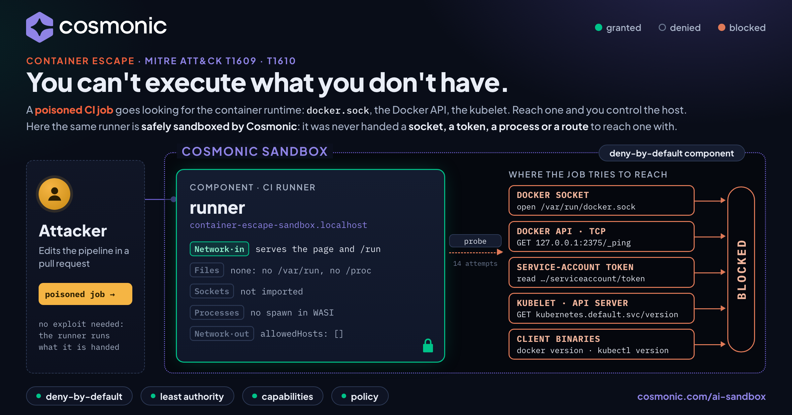

# Stopping a Container Escape with a Sandbox: a live docker.sock demo

**Read the full story on the Cosmonic blog:** [TODO: blog post URL](https://cosmonic.com/blog/TODO-container-escape-sandbox/)



A CI runner executes the steps of whatever job it is handed, and a job is attacker-controlled
input: anyone who can open a pull request that edits the pipeline file can make the runner run
their steps. On a runner that was handed the host's Docker socket, the first thing such a job does
is look for the container runtime's control plane, because whoever can reach it controls the
host. This repo runs that runner, unpatched, inside a deny-by-default
[Cosmonic](https://cosmonic.com/) sandbox, and lets you hand it the poisoned job. Every step runs.
None of them reaches anything.

> **You can't execute what you don't have.** A sandbox doesn't have to recognize the attack. It
> starts with nothing and hands the code only the capabilities you grant: here, inbound HTTP and
> nothing else. See [principles of secure agent platforms](https://cosmonic.com/ai-sandbox/principles/).

**This demo is a reachability probe, not an escape.** The component asks whether a runtime control
plane can be reached (a socket path, a credential path, a client binary, a read-only `GET /_ping`,
`/version` or `/healthz`) and reports the runtime's answer. It contains no code that creates,
starts or configures a container, and neither does the native baseline.

## The scenarios

The demo page has one red button per job. Each hands the runner a job file (`/job?mode=…` shows
it); the runner executes every step with a real call, and nothing is patched.

| Button | Vulnerability (CWE / ATT&CK) | What the attack does | In the sandbox |
|---|---|---|---|
| **Escape via docker.sock** | Poisoned pipeline execution ([CICD-SEC-4](https://owasp.org/www-project-top-10-ci-cd-security-risks/CICD-SEC-04-Poisoned-Pipeline-Execution), [CWE-829](https://cwe.mitre.org/data/definitions/829.html)) on a runner with the runtime socket exposed ([CWE-250](https://cwe.mitre.org/data/definitions/250.html)) · [T1609](https://attack.mitre.org/techniques/T1609/) Container Administration Command · [T1610](https://attack.mitre.org/techniques/T1610/) Deploy Container | Starts the `docker` CLI, looks up `DOCKER_HOST`, lists `/var/run`, opens `/var/run/docker.sock` and `/run/containerd/containerd.sock`, and sends `GET /_ping` and `GET /version` to the Docker API over TCP (`127.0.0.1:2375`, `host.docker.internal:2375`). | 7 of 7 fail. No process to start, no environment, no `/var/run`, no socket file, and the host denies both HTTP requests. |
| **Reach the kubelet / API server** | The same poisoned job, in a pod · [T1613](https://attack.mitre.org/techniques/T1613/) Container and Resource Discovery · [T1552.007](https://attack.mitre.org/techniques/T1552/007/) Container API credentials | Starts `kubectl`, looks up `KUBERNETES_SERVICE_HOST`, reads the service-account token, `/proc/1/cgroup` and `/proc/self/mountinfo`, and sends `GET /version` to the API server and `GET /healthz` to a kubelet. | 7 of 7 fail. No process, no environment, no token, no `/proc`, and the host denies both HTTP requests. |
| **Run all** | both jobs | 14 attempts in one request. | 14 of 14 fail. |

## Why reaching the socket is the whole attack

The Docker daemon runs as root on the host and does what its API is asked to. It has no notion of
which client is asking: a process that can open `/var/run/docker.sock` has the daemon's full
authority, which is the authority to run any container with any option on that host. That is why
the Docker documentation says only trusted users should be allowed to control the daemon
([Docker daemon attack surface](https://docs.docker.com/engine/security/#docker-daemon-attack-surface)),
and why mounting the socket into a build container
(`-v /var/run/docker.sock:/var/run/docker.sock`, often done so a CI job can build images) is the
well-known misconfiguration. The kubelet API and a pod's service-account token are the Kubernetes
versions of the same thing: a control plane within reach of the workload it is supposed to
contain.

So this demo does not need to carry the attack any further than reachability, and it does not.
[`native-demo/`](native-demo/README.md) shows the socket answering from inside a container with the
mount and not answering without it. The sandbox shows the same question having nothing to be asked
through.

## Quickstart

1. **Install [Cosmonic Desktop](https://cosmonic.com/desktop/).** It runs WebAssembly components as
   sandboxed workloads on macOS, Windows and Linux, and listens on `127.0.0.1:8200`.
2. **Apply the manifest.**
   [`deploy/container-escape-sandbox.workload.yaml`](deploy/container-escape-sandbox.workload.yaml)
   pins the published component by digest on ghcr
   (`ghcr.io/cosmonic-labs/demo-container-escape-sandbox/runner`), so there is nothing to build.
   The easiest route is an AI assistant connected to Desktop's MCP server
   ([Connect coding agents](https://cosmonic.com/docs/desktop/coding-agents/)):

   > "Apply `deploy/container-escape-sandbox.workload.yaml` to Cosmonic Desktop, then show me its status."

3. **Open <http://container-escape-sandbox.localhost:8200/>** and press the red buttons.
   `/#docker`, `/#kube` or `/#all` fires that job on load.

### From the command line

| Scenario | Run it | The job file |
|---|---|---|
| Escape via docker.sock | `/run?mode=docker` (the default) | `/job?mode=docker` |
| Reach the kubelet / API server | `/run?mode=kube` | `/job?mode=kube` |
| Run all | `/run?mode=all` | |

```bash
B=http://127.0.0.1:8200; H='Host: container-escape-sandbox.localhost'
curl -s -H "$H" "$B/run?mode=all"       # docker | kube | all, as JSON
curl -s -H "$H" "$B/job?mode=docker"    # the poisoned job the runner is handed
```

A run of `mode=all` reports:

```
MITIGATED: 14 of 14 attempts failed. The poisoned job ran, but the sandbox has no socket path to
open, no token to read, no client to start and no route to a runtime API.
```

`mode=docker`, captured from the running workload (image `0.1.3`; each step's `why` text and the
full import list are trimmed here for width, see below):

```json
{
  "attempts": 7,
  "blocked": 7,
  "mode": "docker",
  "techniques": [
    {
      "attack": "T1609 Container Administration Command, T1610 Deploy Container",
      "id": "docker",
      "name": "Escape via docker.sock",
      "payload": "docker -H unix:///var/run/docker.sock version",
      "steps": [
        { "block": "spawn",    "target": "docker version",
          "call": "std::process::Command::output",
          "result": "operation not supported on this platform", "blocked": true },
        { "block": "discover", "target": "DOCKER_HOST",
          "call": "std::env::var (wasi:cli/environment)",
          "result": "environment variable not found", "blocked": true },
        { "block": "discover", "target": "/var/run",
          "call": "std::fs::read_dir (wasi:filesystem)",
          "result": "No such file or directory (os error 44)", "blocked": true },
        { "block": "socket",   "target": "/var/run/docker.sock",
          "call": "std::fs::OpenOptions::open (wasi:filesystem)",
          "result": "No such file or directory (os error 44)", "blocked": true },
        { "block": "socket",   "target": "/run/containerd/containerd.sock",
          "call": "std::fs::OpenOptions::open (wasi:filesystem)",
          "result": "No such file or directory (os error 44)", "blocked": true },
        { "block": "network",  "target": "http://127.0.0.1:2375/_ping",
          "call": "wasi:http/client.send",
          "result": "host refused the request: ErrorCode::HttpRequestDenied", "blocked": true },
        { "block": "network",  "target": "http://host.docker.internal:2375/version",
          "call": "wasi:http/client.send",
          "result": "host refused the request: ErrorCode::HttpRequestDenied", "blocked": true }
      ]
    }
  ],
  "world": {
    "filesystem_check": {
      "read_dir(\".\")": "No such file or directory (os error 44)",
      "read_dir(\"/\")": "No such file or directory (os error 44)"
    },
    "imports_wasi_sockets": false
  },
  "verdict": "MITIGATED: 7 of 7 attempts failed. The poisoned job ran, but the sandbox has no socket path to open, no token to read, no client to start and no route to a runtime API."
}
```

`mode=kube` gives the same four answers for its seven steps: `operation not supported on this
platform` (`kubectl version`), `environment variable not found` (`KUBERNETES_SERVICE_HOST`),
`No such file or directory (os error 44)` (the token, `/proc/1/cgroup`, `/proc/self/mountinfo`)
and `ErrorCode::HttpRequestDenied` (`https://kubernetes.default.svc/version`,
`https://10.0.0.1:10250/healthz`).

## Why each step fails

| Block | Attempt | The runtime's answer | Why |
|---|---|---|---|
| spawn | `Command::new("docker")`, `Command::new("kubectl")` | `operation not supported on this platform` | WASI has no interface that starts a process: no fork, no exec, no `$PATH` |
| discover | `DOCKER_HOST`, `KUBERNETES_SERVICE_HOST` | `environment variable not found` | The manifest passes no environment |
| discover | list `/var/run`; read `/proc/1/cgroup`, `/proc/self/mountinfo` | `No such file or directory (os error 44)` | No volume is mounted, so no directory exists for a path to resolve under; a component has no `/proc` |
| socket | open `/var/run/docker.sock`, `/run/containerd/containerd.sock` | `No such file or directory (os error 44)` | Same: the socket file is not hidden or permission-denied, it is not in the sandbox |
| secret | read `/var/run/secrets/kubernetes.io/serviceaccount/token` | `No such file or directory (os error 44)` | Same: no volume, so no projected token |
| network | `GET` the Docker API, the Kubernetes API server, a kubelet | `ErrorCode::HttpRequestDenied` | `allowedHosts: []`: the host refuses the request before a connection is made |

The security policy is the workload manifest, and it is short because it grants almost nothing:
one inbound HTTP route, no volumes, no outbound hosts.

### What the component imports

`cosmonic_image_inspect` on the published image
(`ghcr.io/cosmonic-labs/demo-container-escape-sandbox/runner:0.1.3@sha256:0fc7ab82…`) reports these
imports, and `cosmonic_workload_get` reports the same list for the running component:

```
wasi:cli/environment@0.2.6      wasi:cli/exit@0.2.6             wasi:cli/stderr@0.2.6
wasi:cli/stdin@0.2.6            wasi:cli/stdout@0.2.6           wasi:cli/terminal-input@0.2.6
wasi:cli/terminal-output@0.2.6  wasi:cli/terminal-stderr@0.2.6  wasi:cli/terminal-stdin@0.2.6
wasi:cli/terminal-stdout@0.2.6  wasi:clocks/types@0.3.0         wasi:clocks/wall-clock@0.2.6
wasi:filesystem/preopens@0.2.6  wasi:filesystem/types@0.2.6     wasi:http/client@0.3.0
wasi:http/types@0.3.0           wasi:io/error@0.2.6             wasi:io/poll@0.2.6
wasi:io/streams@0.2.6           wasi:random/insecure-seed@0.2.6
```

Read it for what a container escape needs:

- **No `wasi:sockets`.** The component has no function that opens a Unix socket or dials TCP.
  Connecting to `docker.sock` is not refused by a rule; there is no call to make. (The demo opens
  the socket *path* through `wasi:filesystem`, which is the nearest thing it can express.)
- **No process spawn.** WASI defines no such interface, so none can be imported. Rust's
  `std::process::Command` compiles and returns `operation not supported on this platform`.
- **`wasi:filesystem` is imported, and is empty.** Rust's standard library pulls in
  `wasi:filesystem/types` and `/preopens` for any program that touches `std::fs`. An import is a
  door, not a grant: the manifest mounts no volume, so nothing is behind it. This is tested, not
  assumed: every `/run` report carries a `filesystem_check` that lists `/` and `.`, and both fail
  with `No such file or directory`.
- **`wasi:http/client` is the one network path**, and the workload answers it with
  `allowedHosts: []` (Cosmonic Desktop stores an empty list as `localResources: {}`; it is still
  deny-all, which the four `HttpRequestDenied` answers show).

The report's `world.imports` list is a record of that inspection compiled into the component (a
component cannot enumerate its own imports at run time). Re-run `cosmonic_image_inspect` after a
rebuild and update `IMPORTS` in `cosmonic-app/runner/src/lib.rs` if it changes.

## What this demo shows, and what it does not (T1611)

[T1611 Escape to Host](https://attack.mitre.org/techniques/T1611/) covers two different things,
and this demo speaks to only one of them.

- **Escape by way of a reachable control plane** (the mounted socket, a privileged container, the
  kubelet). This demo shows that path is absent: there is no socket, credential, client or route
  for the workload to use, and no container-administration capability exists in WASI to grant by
  mistake.
- **Escape by breaking the isolation mechanism itself** (a kernel or runtime bug). This demo does
  **not** prove that the WebAssembly runtime cannot be broken out of. That isolation is an
  assumption of the threat model. The evidence for it is the runtime's own testing, cited below.

### Cited, not rebuilt

This is a *structural* boundary: there is no host function behind the call. An *enforced*
boundary (a path check, a host allow-list) has to get every input right, so it is worth fuzzing
with evasion inputs; a structural one has no input to evade, so this repo ships no fuzz harness.
(The four HTTP probes do cross an enforced boundary, `allowedHosts`; that one is fuzzed in the
egress demo, not here.) What remains is the runtime half: that Wasm code cannot reach outside its
imports and its linear memory to make a capability for itself. That is tested upstream in
[Wasmtime](https://github.com/bytecodealliance/wasmtime) and not re-proved here:

- [`crates/fuzzing/src/oracles/memory.rs`](https://github.com/bytecodealliance/wasmtime/blob/main/crates/fuzzing/src/oracles/memory.rs):
  the in-bounds and out-of-bounds memory-access oracle.
- [`crates/fuzzing/src/oracles/stacks.rs`](https://github.com/bytecodealliance/wasmtime/blob/main/crates/fuzzing/src/oracles/stacks.rs):
  the control-flow-integrity (stack) oracle.
- [`fuzz/fuzz_targets/differential.rs`](https://github.com/bytecodealliance/wasmtime/blob/main/fuzz/fuzz_targets/differential.rs):
  differential execution against the spec interpreter, wasmi and V8.
- The [WebAssembly spec test suite](https://github.com/WebAssembly/testsuite) (linear-memory
  bounds), and continuous fuzzing of those targets on
  [oss-fuzz](https://github.com/google/oss-fuzz/tree/master/projects/wasmtime).

## The long tail: the same absent capability

The techniques below need the same things the two jobs went looking for. The demo attempts the
first step of T1609, T1610, T1613 and T1552.007 directly; the others are listed because they start
from a control plane the component cannot reach, not because each was fired here.

| Technique | Needs | Missing here |
|---|---|---|
| [T1609](https://attack.mitre.org/techniques/T1609/) Container Administration Command | the runtime's socket or API, or a client binary | no volume; no `wasi:sockets`; no process spawn; `allowedHosts: []` |
| [T1610](https://attack.mitre.org/techniques/T1610/) Deploy Container | the same control plane, to ask for a new container | the same |
| [T1611](https://attack.mitre.org/techniques/T1611/) Escape to Host | a reachable control plane or a privileged container; or a runtime bug | the control-plane path is absent. Runtime isolation is assumed, see above |
| [T1612](https://attack.mitre.org/techniques/T1612/) Build Image on Host | the daemon's build API | the same absent control plane |
| [T1613](https://attack.mitre.org/techniques/T1613/) Container and Resource Discovery | the runtime or Kubernetes API, `/proc`, mounts | no route; no `/proc`; no volume |
| [T1552.007](https://attack.mitre.org/techniques/T1552/007/) Container API credentials | a service-account token or daemon credentials on disk or in the environment | no volume; no environment |
| [T1053.007](https://attack.mitre.org/techniques/T1053/007/) Container Orchestration Job | the orchestrator's API and a credential for it | no route; no credential |

## See the socket answer without a sandbox

[`native-demo/`](native-demo/README.md) is one script, `probe.sh`. It runs a stock `curl` container
twice, once with the Docker socket mounted and once without, and from inside each asks
`GET /_ping` and `GET /version`. With the mount, the daemon answers:

```
== 1. container WITH the Docker socket mounted (the misconfiguration)
GET /_ping -> OK  (curl exit 0)
GET /version -> {"Platform":{"Name":"Docker Desktop 4.78.0 (229452)"},"Version":"29.5.3","ApiVersion":"1.54", …}
  (curl exit 0)

== 2. container WITHOUT the mount
GET /_ping -> curl: (7) Failed to connect to localhost port 80 after 0 ms: Could not connect to server
  (curl exit 7)
```

It stops there. Needs Docker; it pulls one small public image and creates nothing but its own two
`--rm` containers.

## How it's built

One workload, one WebAssembly component.

| Component | Filesystem | Network | HTTP | Job |
|---|---|---|---|---|
| `runner` | none | no egress | serves `wasi:http/handler` | the UI, and the step interpreter that runs the job |

The runner's flaw is in [`cosmonic-app/runner/src/job.rs`](cosmonic-app/runner/src/job.rs), marked
`// VULN:`: it executes every step in the job file, with no allow-list of step kinds or targets and
no question about where the job came from. The probes each step maps to are in
[`probes.rs`](cosmonic-app/runner/src/probes.rs). See
[`cosmonic-app/README.md`](cosmonic-app/README.md).

The same manifest runs on Kubernetes with [Cosmonic Control](https://cosmonic.com/control/) once
the image is signed and published to a registry the cluster can pull from, and the
`unsafe-allow-unsigned` annotation is removed.

## Repo layout

```
.
├── deploy/container-escape-sandbox.workload.yaml   one workload, one component, no grants (pinned by digest)
├── cosmonic-app/
│   └── runner/                    the CI runner component (Rust, wasip3 HTTP handler)
│       ├── .wash/config.yaml      build command and the (empty) grants
│       └── src/
│           ├── lib.rs             routes, the report, the recorded import list
│           ├── job.rs             the two poisoned jobs and the step interpreter (the bug)
│           ├── probes.rs          the reachability probes; each reports the runtime's error
│           └── page.rs            the branded UI
├── native-demo/                   probe.sh: the same question against a mounted docker.sock
└── docs/
    ├── hero/                      hero source (HTML) and render.sh
    └── images/                    hero image
```

## Status

Built, deployed on Cosmonic Desktop 0.5.33 and verified live: the page returns 200, and
`/run?mode=docker`, `kube` and `all` return 7 of 7, 7 of 7 and 14 of 14 attempts failed. Notes:

- The image is in Desktop's local registry only. It is not published to ghcr, so the quickstart
  includes a build step, unlike the zip demo.
- There is no `wit/` directory. The component uses the `wasip3` crate's stock HTTP world and has
  no private interface to declare.
- The blog URL at the top is a placeholder.

## Keep reading

[Choosing an agent sandbox](https://cosmonic.com/ai-sandbox/choosing-an-agent-sandbox/) ·
[Deny by default](https://cosmonic.com/ai-sandbox/principles/deny-by-default/) ·
[Least authority](https://cosmonic.com/ai-sandbox/least-privilege-ai-agents/) ·
[Capabilities over ambient authority](https://cosmonic.com/ai-sandbox/capabilities/)

## License

Apache-2.0. See [LICENSE](LICENSE).
