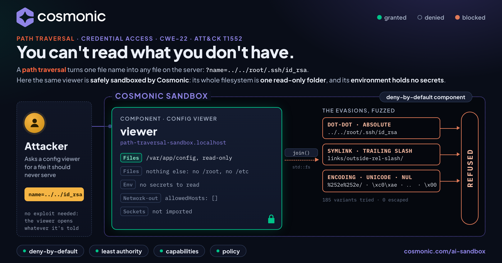

# You can't read what you don't have: a path-traversal sandbox demo (MITRE ATT&CK T1552)

**Read the full story on the Cosmonic blog:** [TODO: blog post title](https://cosmonic.com/blog/TODO-path-traversal-sandbox/) (placeholder URL)



A "config viewer" takes a file name from the request, joins it onto its config directory and
opens the result. That is CWE-22, path traversal, and on an ordinary server asking it for
`../../root/.ssh/id_rsa` hands over the private key
([ATT&CK T1552, Unsecured Credentials](https://attack.mitre.org/techniques/T1552/)).

This repo runs that viewer, unpatched, inside a deny-by-default [Cosmonic](https://cosmonic.com/)
sandbox whose entire filesystem is one read-only directory, and lets you send traversals at it.
The name reaches the filesystem exactly as sent. The runtime refuses it, and there is nothing
outside that one directory for it to find.

> **You can't execute what you don't have.** A sandbox doesn't have to recognize the attack. It
> starts with nothing and hands the code only the capabilities you grant: here, one read-only
> folder, an empty environment and no network. See
> [principles of secure agent platforms](https://cosmonic.com/ai-sandbox/principles/).

This is a unit test of the runtime's security boundary, not offensive tooling. Nothing here reads
a real credential. The only thing outside the sandbox that the tests reach for is a harmless
canary file this repo plants for the purpose (in the hostPath deployment; the default deployment
has nothing outside its volume at all).

## The scenarios

The demo page has one button per scenario. Each sends a real request to the viewer; nothing is
patched and nothing is filtered.

| Button | Vulnerability (CWE / ATT&CK) | What the attack does | In the sandbox |
|---|---|---|---|
| **Read /root/.ssh/id_rsa** | [CWE-22](https://cwe.mitre.org/data/definitions/22.html) · [T1552.004](https://attack.mitre.org/techniques/T1552/004/) | Asks the viewer for `../../root/.ssh/id_rsa`. The viewer joins it onto `/var/app/config` and opens `/var/app/config/../../root/.ssh/id_rsa`. | Refused by the runtime: `Operation not permitted (os error 63)`. `..` cannot leave the preopen. |
| **Try this variant** (dropdown) | CWE-22, [CWE-59](https://cwe.mitre.org/data/definitions/59.html), [CWE-61](https://cwe.mitre.org/data/definitions/61.html) evasions | The same goal spelled another way: absolute paths, symlinks, symlinks with trailing slashes, percent- and double-encoding, overlong and invalid UTF-8, Unicode look-alikes, backslashes, NUL bytes, very long paths. | Each one is refused with the runtime's own error, or resolves to a file that really is inside the directory. |
| **Run the fuzz corpus** | every variant at once | Runs the whole corpus and compares every successful read and listing against an inventory of what is really inside the directory. | `174 variants tried, 0 escaped` from the page; `185 variants tried, 0 escaped` from the CLI harness on the hostPath deployment (see [Fuzzing the boundary](#fuzzing-the-boundary)). |
| **View app.conf** | none (the legitimate path) | Asks for `app.conf`. | Served: `inside: 249 bytes, identical to app.conf`. The sandbox removes what was never needed, not what was. |
| **Show environment** | [T1552.001](https://attack.mitre.org/techniques/T1552/001/) · [T1552.007](https://attack.mitre.org/techniques/T1552/007/) | Lists every environment variable and preopened directory the component can see, `stat`s twelve well-known credential paths, and tries to write to the mount. | 0 environment variables, 1 preopen, 0 of 12 credential paths visible, every write refused. |

The bug is the line marked `// VULN:` in
[`cosmonic-app/viewer/src/viewer.rs`](cosmonic-app/viewer/src/viewer.rs):

```rust
PathBuf::from(CONFIG_ROOT).join(name)   // no canonicalization, no `..` filter, no prefix check
```

**In your own code, fix the bug**: canonicalize and check the prefix, or open files relative to a
directory handle. The sandbox is the layer that holds when that fix is missing.

## Quickstart

1. **Install [Cosmonic Desktop](https://cosmonic.com/desktop/).** It runs WebAssembly components as
   sandboxed workloads on macOS, Windows and Linux, and listens on `127.0.0.1:8200`.
2. **Nothing to build.** The manifests pin the three published components by digest on ghcr
   (`ghcr.io/cosmonic-labs/demo-path-traversal-sandbox/{web,viewer,seeder}`). To run your own
   build instead, see [Build from source](#build-from-source).
3. **Pick a manifest.** The default,
   [`deploy/path-traversal-sandbox.workload.yaml`](deploy/path-traversal-sandbox.workload.yaml),
   uses an `ephemeral` volume that the `seeder` fills at startup: nothing to edit, and the same
   shape runs on a Cosmonic Control cluster. To run the CLI fuzz harness with a real canary
   outside the mount, use
   [`deploy/path-traversal-sandbox.fuzz.workload.yaml`](deploy/path-traversal-sandbox.fuzz.workload.yaml)
   instead: set `volumes[0].hostPath.path` to the absolute path of `deploy/volume/config` in your
   clone and run `fuzz/plant.sh`.
4. **Apply the manifest.** The easiest route is an AI assistant connected to Desktop's MCP server
   ([Connect coding agents](https://cosmonic.com/docs/desktop/coding-agents/)):

   > "Apply `deploy/path-traversal-sandbox.workload.yaml` to Cosmonic Desktop, then show me its status."

5. **Open <http://path-traversal-sandbox.localhost:8200/>** and press the buttons.

> **One gotcha.** The viewer needs its `/var/app/config` volume. Desktop's quick-deploy paths
> (`cosmonic dev`, publish drafts, pasting an image link) build a spec from the image alone and drop
> the `volumes` section; the viewer then has no preopen at all and even `app.conf` is not found.
> Apply the manifest as written.

> **Only mount the sample directory** (hostPath manifest). `deploy/volume/config` holds inert
> sample files made for this demo. Never point the volume at a directory with anything real in it.

### From the command line

| Scenario | Run it |
|---|---|
| Read /root/.ssh/id_rsa | `/run?mode=ssh` (the default) |
| View app.conf | `/run?mode=benign` |
| Any name you like | `/run?mode=read&name=<percent-encoded>` or `POST /run?mode=read` with the raw name as the body |
| One corpus variant | `/run?mode=variant&id=<n>` (list them with `/run?mode=corpus`) |
| The whole corpus | `/run?mode=fuzz` |
| Environment | `/run?mode=env` |
| Everything, summarised | `/run?mode=all` |
| What the seeder wrote | `/run?mode=seed-report` (default manifest only) |

```bash
B=http://127.0.0.1:8200
curl -s -H 'Host: path-traversal-sandbox.localhost' "$B/run?mode=ssh" | python3 -m json.tool
```

Captured from the live deployment (Cosmonic Desktop 0.5.33, runtime 2.12.0, macOS/aarch64; the
answers below are the same on both manifests):

```json
{
    "requested": "../../root/.ssh/id_rsa",
    "requested_bytes": 22,
    "joined_path": "/var/app/config/../../root/.ssh/id_rsa",
    "outcome": "refused",
    "std_fs": {
        "read": "refused: Operation not permitted (os error 63)",
        "list": "refused: Operation not permitted (os error 63)",
        "stat": "refused: Operation not permitted (os error 63)"
    },
    "wasi_open_at": {
        "read": "refused: Operation not permitted, similar to `EPERM` in POSIX. (wasi:filesystem error-code `not-permitted`)",
        "list": "refused: Operation not permitted, similar to `EPERM` in POSIX. (wasi:filesystem error-code `not-permitted`)",
        "stat": "refused: Operation not permitted, similar to `EPERM` in POSIX. (wasi:filesystem error-code `not-permitted`)"
    },
    "wasi_open_at_skipped": null,
    "verdict": "CONTAINED: \"../../root/.ssh/id_rsa\" went to the filesystem unmodified and the sandbox answered: Operation not permitted (os error 63). Nothing outside /var/app/config was read."
}
```

Each name is tried two ways: `std_fs` is the viewer's own code path (`Path::join`, then `std::fs`
through wasi-libc), and `wasi_open_at` calls `wasi:filesystem` `open-at` directly on the preopen
descriptor, with no libc path handling in between. Each way tries read, list and stat.

The absolute form, `/run?mode=read&name=/root/.ssh/id_rsa`, makes `Path::join` discard the config
directory altogether. Inside the sandbox that path does not exist:
`No such file or directory (os error 44)`.

`/run?mode=benign`:

```json
{
    "requested": "app.conf",
    "joined_path": "/var/app/config/app.conf",
    "outcome": "inside",
    "std_fs": {
        "read": "inside: 249 bytes, identical to app.conf",
        "list": "refused: Not a directory (os error 54)",
        "stat": "ok: file, 249 bytes"
    },
    "content": "# app.conf: sample configuration for the config-viewer demo.\n...",
    "verdict": "OK: \"app.conf\" resolved inside /var/app/config (inside: 249 bytes, identical to app.conf)."
}
```

`/run?mode=env` (abridged; all twelve credential paths return the same error):

```json
{
    "sandbox_root": "/var/app/config",
    "env_vars": [],
    "secret_like_env_vars": [],
    "args": [],
    "cwd": "/",
    "preopens": ["/var/app/config"],
    "root_listing": "refused: No such file or directory (os error 44)",
    "credential_paths": [
        {"path": "/root/.ssh/id_rsa", "looks_for": "SSH private key (T1552.004)", "result": "refused: No such file or directory (os error 44)"},
        {"path": "/etc/shadow", "looks_for": "password hashes (T1003.008)", "result": "refused: No such file or directory (os error 44)"}
    ],
    "write_probes": [
        {"attempt": "create /var/app/config/.write-probe", "allowed": false, "result": "refused: Operation not permitted (os error 63)"},
        {"attempt": "mkdir /var/app/config/.write-probe-dir", "allowed": false, "result": "refused: Operation not permitted (os error 63)"},
        {"attempt": "open /var/app/config/app.conf for append", "allowed": false, "result": "refused: Operation not permitted (os error 63)"}
    ],
    "verdict": "NOTHING TO STEAL: 0 environment variable(s), 0 that look like credentials; 1 preopen(s): [\"/var/app/config\"]; 0 of 12 well-known credential paths visible; mount is read-only (every write attempt was refused)."
}
```

The create and mkdir probes run against every directory the host preopened, not just
`/var/app/config`, so a mount the viewer was never meant to have would show up here.

`/run?mode=all` ends with (hostPath manifest):

```
CONTAINED: ../../root/.ssh/id_rsa -> refused: Operation not permitted (os error 63);
app.conf -> inside: 249 bytes, identical to app.conf; 0 environment variable(s), 0 credential-like;
1 preopen(s), every write refused; fuzz: 174 variants tried, 0 escaped.
```

On the default (ephemeral) manifest the last clause reads
`fuzz: 174 variants tried, 0 escaped (4 of 16 symlink fixtures absent from this volume).`
See [The default deployment](#the-default-deployment-ephemeral-volume-no-canary).

## Fuzzing the boundary

A preopen is an **enforced** boundary: the runtime checks each path at call time. Checks like
that are what evasion is aimed at, so this repo ships an adversarial harness that asserts
containment instead of assuming it.

```bash
# needs the hostPath manifest: deploy/path-traversal-sandbox.fuzz.workload.yaml
fuzz/plant.sh               # once: plant the symlink fixtures inside the mounted directory
python3 fuzz/run.py         # drive the deployed viewer with every variant
python3 fuzz/run.py -v      # print each variant and the runtime's answer
```

Everything in this section up to [The default deployment](#the-default-deployment-ephemeral-volume-no-canary)
was measured on the **hostPath** manifest, which is the only one with a canary outside the mount.

Result against the live hostPath deployment (Cosmonic Desktop 0.5.33, runtime 2.12.0,
macOS/aarch64):

```
185 variants tried, 0 escaped
  refused by the runtime:        170
  resolved inside the preopen:   15
  legitimate reads served:       10/10
  filesystem calls attempted:    1071
  component's own run:           185 variants tried, 0 escaped
  host baseline, no sandbox:     23 of 111 canary-seeking names reach the canary natively
```

**How an escape is detected without touching anything real.** The volume layout is:

```
deploy/volume/
├── config/              the ONLY directory mounted (at /var/app/config, read-only)
│   ├── app.conf  database.conf  profiles/
│   └── links/           symlinks planted by fuzz/plant.sh (from fuzz/links.txt); most point OUT of config/
└── outside/CANARY.txt   NOT mounted. A harmless marker file.
```

From inside the preopen the canary is at `../outside/CANARY.txt`. A variant has escaped if the
response contains the canary's marker line, or carries file content that is not byte-identical to
a file inside `config/`, or if the component reports it. The component keeps its own inventory of
the preopen and checks every successful read and every successful directory listing against it; a
`stat` that succeeds where read and list are refused also counts. If outside content ever did come
back, the component withholds it unless it is the canary.

**The corpus** ([`fuzz/corpus.txt`](fuzz/corpus.txt), 185 labelled variants, compiled into the
component so the page and the CLI test the same thing):

| Class | Variants | Outcome on this deployment |
|---|---|---|
| Controls (legitimate names, inside symlinks) | 10 | all served |
| `..` traversal, listings, trailing slashes, filter bypasses (`....//`, `..;/`) | 25 | all refused |
| Absolute paths and `file:` URLs | 11 | all refused |
| Symlinks pointing out (relative, absolute, chains, to `/`, a loop, case-folded) | 18 | 17 refused; 1 case-folded *inside* link resolved inside |
| **Symlinks with trailing slashes** (on the request, on the link target, both) | 29 | 27 outward variants refused; of 2 inside links, 1 listed inside and 1 refused |
| Percent-encoding and double/triple encoding | 17 | all refused (never decoded by the runtime) |
| Overlong and invalid UTF-8 | 13 | all refused: `Illegal byte sequence (os error 25)` |
| Unicode look-alike dots and slashes, invisible characters, NFC/NFD, case | 22 | 20 refused; 2 inside spellings (NFD, upper case) resolved inside |
| Windows separators, drive, UNC and stream syntax | 14 | all refused |
| NUL bytes | 8 | all refused: `file name contained an unexpected NUL byte` |
| Whitespace and control characters | 7 | all refused |
| Very long paths (4 KB to 70 KB, 300 levels of `../`) | 11 | 10 refused; 1 inside name resolved inside |

Things worth knowing about these numbers:

- **174 on the page, 185 from the CLI.** Eleven variants embed the absolute *host* path of the
  canary directory. The component tries to learn that path by reading an absolute symlink planted
  in its own directory and is refused (`Operation not permitted (os error 63)`), so it cannot build
  those names. The CLI harness runs on the host, knows the path, and supplies it.
- **"Resolved inside" is not an escape.** macOS filesystems are case-insensitive and
  normalization-insensitive, so `APP.CONF` and a decomposed `café.conf` name the same inside
  files. The corpus classes those as `equivalent`. The case-folded *outward* links
  (`LINKS/CANARY-REL`) are refused.
- **The corpus is real.** Opened natively on the same host with no sandbox, 23 of the 111
  canary-seeking names reach the canary. The rest are spellings that only work against a
  decoding or normalizing layer, which is the point of trying them.
- **Percent-encoding is tested after one decode.** The HTTP layer decodes the query once, as any
  server does; what the corpus sends is what is left.

**Conformance baseline.** The evasion corpus is layered on top of, not instead of, the upstream
[`WebAssembly/wasi-testsuite`](https://github.com/WebAssembly/wasi-testsuite), whose filesystem
cases (`..` at the preopen root, absolute paths, symlink following, trailing slashes) are the
conformance baseline for any WASI runtime. That suite is cited here, not vendored or re-run.

### The default deployment: ephemeral volume, no canary

The default manifest has no host directory. Its volume starts empty and the `seeder` writes the
same four sample files and as many of the `links/` fixtures as the runtime lets it create. Nothing
exists outside the volume for a canary to live in, so the CLI harness (which compares against the
host directory and the canary) does not apply. The component's own run still does, because it
decides "escaped" by content: any read or listing that is not byte-identical to its inventory of
the preopen.

Measured on the default manifest after a cold start (Cosmonic Desktop 0.5.33, runtime 2.12.0,
macOS/aarch64), `/run?mode=fuzz`:

```
174 variants tried, 0 escaped (4 of 16 symlink fixtures absent from this volume)
  refused: 159 · resolved inside the preopen: 15 · legitimate reads served: 10/10
  filesystem calls: 1005 · host-path variants skipped: 11
```

What is different from the hostPath run, and what that means:

- **Four links could not be created.** The runtime refused `symlink-at` for every absolute
  target (`canary-abs`, `outside-abs`, `outside-abs-slash`, `root-abs`) with
  `Operation not permitted` (`wasi:filesystem` error-code `not-permitted`). The twelve relative
  links, including the ones pointing out of the volume, were created. `/run?mode=seed-report`
  shows the seeder's record and `symlink_fixtures_absent` in the fuzz report lists them.
- **Ten of the 174 variants name one of those absent links** and are answered
  `No such file or directory`. That is the link not being there. It says nothing about whether
  the runtime would have followed it; the hostPath run is the one that tests those.
- **The outward relative links dangle.** `links/canary-rel` points at `../../outside/CANARY.txt`,
  and there is no such file beside an ephemeral volume. The runtime still refuses to follow them
  (`Operation not permitted`), but "0 escaped" here is a weaker statement than on the hostPath
  run, where the canary really is one `..` away.
- The inventory holds five files, not four: the seeder leaves `.seed-report.json` in the volume.

### Why this demo is fuzzed: enforced boundaries have been escaped

`CVE-2026-115392` is a cap-std filesystem sandbox escape via trailing-slash symlinks (CWE-61), on
macOS and on Linux kernels without `openat2`. cap-std is the library that resolves paths inside a
preopen for Wasmtime-based runtimes. It is evidence that an **enforced** boundary is
implementation-dependent and has been escaped, unlike **structural** absence, where the capability
does not exist to be reached at all. That is why this demo carries a fuzz harness with a dedicated
trailing-slash symlink class, and why the sibling demos that rest on structural absence (memory,
container, pivot) are the stronger claims.

On this deployment, which is macOS, all 27 outward trailing-slash symlink variants were refused.
That is a statement about this build of the runtime on this host on the day it was run. It is not
a statement about other versions, other operating systems, or names that are not in the corpus.

## Findings

None. No variant returned content from outside the preopen in the run recorded above.

If a variant ever does escape, it is a real finding: record the exact variant and the observed
behavior here, report it upstream (to the runtime, and to cap-std if path resolution is at fault),
and do not develop it further.

## See it fail without a sandbox

[`native-demo/`](native-demo/README.md) is a small CLI that runs the same path join as an ordinary
process, so you can watch the traversal succeed first. It builds a throwaway directory tree under
the system temp directory with a fake "private key" of inert text beside the config directory,
reads it back through the bug, and deletes the tree. It never opens a real file such as `~/.ssh`.

```bash
cd native-demo
cargo run
```

It ends with `VULNERABLE: 4 of 4 requests read the fake key from outside the config directory.`
Same code; the only difference is what the code was handed.

## How it's built

One workload, three WebAssembly components, each its own sandbox with its own grants. `web`
passes the requested name to `viewer` over a private interface inside the host; the browser only
ever talks to `web`. `seeder` is the workload's run-once `service`: the host runs it when the
workload starts, it fills the volume and exits.

| Component | Filesystem | Network | HTTP | Job |
|---|---|---|---|---|
| `web` | none | no egress | serves `wasi:http/handler` | UI; forwards the name as raw bytes |
| `viewer` | `/var/app/config` only, read-only | no egress | none, reachable only through the link | the config viewer, with the bug |
| `seeder` | the same volume at `/seed`, read-write (read-only in the hostPath manifest) | no egress | none; linked to nothing | writes the sample files compiled into it, once, at startup; takes no input |

**Why the seeder is a service and not something `web` calls.** In this runtime, components that
are linked through an interface are instantiated in one store, and each then sees the volume
mounts of all the others. We built it that way first (`web` importing a `seeding` interface) and
measured it on Cosmonic Desktop 0.5.33: the viewer reported two preopens, `/var/app/config` and
`/seed`, and its write probes on `/seed` were **allowed**. A per-component `readOnly: true` does
not survive being linked to a component that mounts the same volume read-write. A service that
shares no interface with anything gets its own store; with the seeder moved there the viewer is
back to one preopen and every write is refused. If you extend this demo, keep whatever holds
write access out of the link graph, and check `/run?mode=env`.

Those grants are the whole mitigation:

- **`..` has nowhere to go.** The preopen is the root of everything `viewer` can name. The runtime
  resolves every path against that one directory handle and refuses a path that would leave it,
  whether by `..`, by an absolute path, or through a symlink.
- **Absolute paths name nothing.** There is no `/root`, no `/etc`, no `/`. `read_dir("/")` fails
  with `No such file or directory`.
- **The environment is empty.** The workload passes no environment variables, so there is no
  token to read from one. Secrets a real workload needs are granted by named reference, not
  inherited.
- **Read-only is enforced.** The mount is `readOnly: true`. Create, open-for-append and mkdir are
  all refused with `Operation not permitted`. To check that the flag is what does it, the same
  workload was applied once with `readOnly: false`: all three writes then succeeded. So the
  viewer can't plant a symlink or overwrite a config either.
- **Nothing phones home.** All three components ship `allowedHosts: []`. A file the viewer did read
  could not be sent anywhere.

Confirmed with `cosmonic_image_inspect`: `viewer` imports `wasi:filesystem/{preopens,types}`,
`wasi:cli/*`, `wasi:clocks/wall-clock` and `wasi:io/*`, and nothing else: no `wasi:http`, no
`wasi:sockets`. `web` imports `cosmonic:path-demo/viewing`, `wasi:http/types`, `wasi:cli/*`,
`wasi:io/*`, `wasi:clocks/{monotonic-clock,types}` and `wasi:random/insecure-seed`: no
`wasi:filesystem` at all. `seeder` exports `wasi:cli/run` and imports the same WASI set as
`viewer`; neither it nor anything else imports or exports an interface that links it to the other
two. `cosmonic_workload_get` shows the single `volumeMounts` entry on `viewer` with
`readOnly: true`. (Desktop stores
`allowedHosts: []` as an empty `localResources`; it is still deny-all.)

**The volume** comes in two forms, one per manifest. The default is `ephemeral`: empty at start,
filled by `seeder`, gone when the workload is deleted, and needing nothing on the host. The fuzz
variant is a `hostPath` volume, a directory of sample files in this repo, so the harness can plant
symlinks with real host targets and a canary beside it. That one carries an absolute path you must
edit, and what is mounted is exactly what you point it at.

The default manifest is the shape that runs on Kubernetes with
[Cosmonic Control](https://cosmonic.com/control/) (the Workload CRD has only `ephemeral` and
`hostPath` volumes, and a cluster has no checkout to point at), where you can enforce these grants
with admission policies. It has been run on Cosmonic Desktop only; the cluster deployment is not
verified here. See
[Securing a cluster](https://cosmonic.com/docs/operations/securing-a-cluster/).

## What else this boundary covers

The same two facts (one preopen, an empty environment) are what stand in the way of the
neighbouring techniques. This demo exercises them only as far as stated; "not visible" below means
a `stat` on the usual path returned `No such file or directory` in the `/run?mode=env` report.

| Technique | What it needs | What this demo shows |
|---|---|---|
| [T1552.001](https://attack.mitre.org/techniques/T1552/001/) Credentials In Files | a readable file holding credentials | Only the mounted directory is readable. Credentials *placed in* that directory would be readable: don't put them there. |
| [T1552.003](https://attack.mitre.org/techniques/T1552/003/) Shell History | `~/.bash_history` | Not visible. There is no home directory and no shell. |
| [T1552.004](https://attack.mitre.org/techniques/T1552/004/) Private Keys | `~/.ssh/id_rsa` and similar | The headline button, and the fuzz corpus. |
| [T1552.007](https://attack.mitre.org/techniques/T1552/007/) Container API | service-account token files, env vars | Token path not visible; environment empty. |
| [T1003.008](https://attack.mitre.org/techniques/T1003/008/) /etc/passwd and /etc/shadow | those two files | Not visible. |
| [T1555](https://attack.mitre.org/techniques/T1555/) Credentials from Password Stores | keychain and browser store files | The usual paths are not visible. OS keychain APIs are not WASI interfaces; that half is by construction and is not exercised here. |
| [T1528](https://attack.mitre.org/techniques/T1528/) Steal Application Access Token | token files, env vars | Token paths not visible; environment empty. A token deliberately granted to a workload is still usable by that workload. |
| [T1083](https://attack.mitre.org/techniques/T1083/) File and Directory Discovery | listing directories | Listing works inside the preopen only. `/`, the mount's parent and every outward symlink are refused. |
| [T1005](https://attack.mitre.org/techniques/T1005/) Data from Local System | reading local files | Limited to the granted directory. The sandbox narrows the blast radius to what was granted; it does not protect granted data from the code it was granted to. |

## Build from source

```bash
cd cosmonic-app/viewer && cargo build --target wasm32-wasip2 --release
cd ../web              && cargo build --target wasm32-wasip2 --release
cd ../seeder           && cargo build --target wasm32-wasip2 --release
cd ../..
# publish to Desktop's built-in registry (bump the tag on every re-push: a reused tag keeps
# serving the old build), then point the image: lines in both manifests under deploy/ at them
wash oci push --insecure oci.localhost:8200/apps/path-traversal-sandbox-seeder:<tag> \
  cosmonic-app/seeder/target/wasm32-wasip2/release/path_traversal_seeder.wasm
wash oci push --insecure oci.localhost:8200/apps/path-traversal-sandbox-viewer:<tag> \
  cosmonic-app/viewer/target/wasm32-wasip2/release/path_traversal_viewer.wasm
wash oci push --insecure oci.localhost:8200/apps/path-traversal-sandbox-web:<tag> \
  cosmonic-app/web/target/wasm32-wasip2/release/path_traversal_web.wasm
```

Cosmonic Desktop's Preflight check installs `rustc`, the `wasm32-wasip2` target and `wash` for you.
The hero image is rendered from [`docs/hero/`](docs/hero/) with `docs/hero/render.sh`.

## Repo layout

```
.
├── deploy/
│   ├── path-traversal-sandbox.workload.yaml        default: ephemeral volume, filled by the seeder
│   ├── path-traversal-sandbox.fuzz.workload.yaml   hostPath variant for the fuzz harness and canary
│   └── volume/
│       ├── config/                            the sample config files (mounted by the hostPath
│       │                                      variant; compiled into the seeder for the default)
│       └── outside/CANARY.txt                 the fuzz canary, deliberately NOT mounted
├── cosmonic-app/
│   ├── wit/                                   cosmonic:path-demo/viewing, the link
│   ├── web/                                   UI component: no filesystem, no network
│   ├── viewer/                                the vulnerable viewer: one read-only folder, no network
│   └── seeder/                                run-once service: writes the sample files into the volume
├── fuzz/
│   ├── corpus.txt                             185 labelled evasion variants
│   ├── links.txt                              the symlink fixtures (read by plant.sh, seeder, viewer)
│   ├── plant.sh                               plants the symlink fixtures in config/links/
│   └── run.py                                 drives the deployed viewer, asserts 0 escapes
├── native-demo/                               CLI that runs the same bug with no sandbox
└── docs/                                      hero image and its source
```

## Keep reading

[Choosing an agent sandbox](https://cosmonic.com/ai-sandbox/choosing-an-agent-sandbox/) ·
[Deny by default](https://cosmonic.com/ai-sandbox/principles/deny-by-default/) ·
[Least authority](https://cosmonic.com/ai-sandbox/least-privilege-ai-agents/) ·
[Capabilities over ambient authority](https://cosmonic.com/ai-sandbox/capabilities/)

Questions, or a case where this breaks? Find us in the [wasmCloud Slack](https://slack.wasmcloud.com/).
